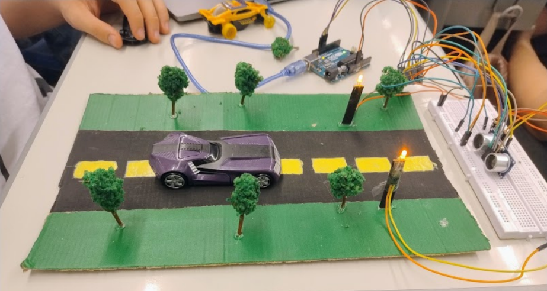

# Smart Street Light System with Arduino

An automated street lighting prototype built with Arduino and an HC-SR04 ultrasonic sensor.

## About the Project

This project simulates an automated street lighting system that detects approaching objects and activates the lights accordingly.

The ultrasonic sensor measures the distance to nearby objects. When an object is detected within 27 cm, two LEDs turn on for 10 seconds, simulating street lights illuminating a road.

The project demonstrates a simple application of automation in public lighting, with the goal of reducing unnecessary energy consumption.

## Project Preview

## Components

- Arduino board
- HC-SR04 ultrasonic sensor
- 2 LEDs
- Breadboard
- Jumper wires
- Miniature street model

## How It Works

1. The HC-SR04 sensor measures the distance to nearby objects.
2. The Arduino processes the measurement.
3. If an object is detected within 27 cm, both LEDs turn on.
4. The LEDs stay on for 10 seconds and then turn off.
5. Distance readings are displayed in the Serial Monitor.

## Pin Configuration

| Component | Arduino Pin |
|---|---:|
| HC-SR04 Trig | 11 |
| HC-SR04 Echo | 10 |
| LED 1 | 13 |
| LED 2 | 12 |

## Technologies and Tools

- Arduino
- C/C++
- Arduino IDE
- HC-SR04 ultrasonic sensor

## My Contribution

Developed as a group academic project at Fundação Bradesco. I was responsible for writing the Arduino code and assembling the circuit, including the connections between the board, sensor, LEDs, and jumper wires.

## Source Code

The code is available in [`smart_street_light.ino`](smart_street_light.ino).
